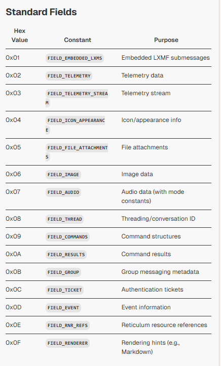

LXMF messages include an optional, extensible `fields` dictionary within their payload, enabling structured metadata and custom content. Standard fields are defined by constants in `LXMF/LXMF.py` and are used by `LXMessage` during packing/unpacking

## Standard Fields

| Hex Value | Constant | Purpose |
|-----------|----------|---------|
| 0x01 | `FIELD_EMBEDDED_LXMS` | Embedded LXMF submessages |
| 0x02 | `FIELD_TELEMETRY` | Telemetry data |
| 0x03 | `FIELD_TELEMETRY_STREAM` | Telemetry stream |
| 0x04 | `FIELD_ICON_APPEARANCE` | Icon/appearance info |
| 0x05 | `FIELD_FILE_ATTACHMENTS` | File attachments |
| 0x06 | `FIELD_IMAGE` | Image data |
| 0x07 | `FIELD_AUDIO` | Audio data (with mode constants) |
| 0x08 | `FIELD_THREAD` | Threading/conversation ID |
| 0x09 | `FIELD_COMMANDS` | Command structures |
| 0x0A | `FIELD_RESULTS` | Command results |
| 0x0B | `FIELD_GROUP` | Group messaging metadata |
| 0x0C | `FIELD_TICKET` | Authentication tickets |
| 0x0D | `FIELD_EVENT` | Event information |
| 0x0E | `FIELD_RNR_REFS` | Reticulum resource references |
| 0x0F | `FIELD_RENDERER` | Rendering hints (e.g., Markdown) |

## R3AKT Control-Plane Profile (Normative)

R3AKT distinguishes command intent, command outcomes, and immutable events by LXMF field usage:

| Semantic class | Required field | Hex | Rule |
|---|---|---|---|
| Command intent | `FIELD_COMMANDS` | 0x09 | Used for requests/actions only |
| Command outcome (`accepted`/`rejected`/`result`) | `FIELD_RESULTS` | 0x0A | Used for command lifecycle replies |
| Event fact/snapshot | `FIELD_EVENT` | 0x0D | Used for immutable event-plane facts |
| Group/topic metadata | `FIELD_GROUP` | 0x0B | Optional metadata for fan-out scope; never the class discriminator |

Rules:

- Command messages MUST include `FIELD_COMMANDS` and MUST NOT be treated as events.
- Command replies MUST include `FIELD_RESULTS` and MUST reference the originating `command_id`.
- Event messages MUST include `FIELD_EVENT` and MUST NOT carry command intent.
- `FIELD_GROUP` MAY be present with commands, results, or events for scoped delivery (missions/topics).

## Custom and Debug Fields

- `FIELD_CUSTOM_TYPE` (0xFB), `FIELD_CUSTOM_DATA` (0xFC), `FIELD_CUSTOM_META` (0xFD): For application-specific extensions and bridging external protocols [3](#0-2) .
- `FIELD_NON_SPECIFIC` (0xFE), `FIELD_DEBUG` (0xFF): For development and debugging [4](#0-3) .

## Usage in Messages

- The `fields` dictionary is msgpacked as the fourth element of the message payload `[timestamp, title, content, fields]` [2](#0-1) .
- During unpacking, fields are restored into `message.fields` [5](#0-4) .
- Example: In `lxmf_delivery`, `FIELD_TICKET` is checked to handle authentication tickets [6](#0-5) .

## Notes

- Audio fields use mode constants (Codec2/Opus) defined in `LXMF.py` [7](#0-6) .
- Renderer fields use constants like `RENDERER_MARKDOWN` [8](#0-7) .
- Fields are optional; the dictionary may be empty [9](#0-8) .

Wiki pages you might want to explore:
- [Overview (markqvist/LXMF)](/wiki/markqvist/LXMF#1)
- [API Reference (markqvist/LXMF)](/wiki/markqvist/LXMF#8)

### Citations


```python
FIELD_EMBEDDED_LXMS    = 0x01
FIELD_TELEMETRY        = 0x02
FIELD_TELEMETRY_STREAM = 0x03
FIELD_ICON_APPEARANCE  = 0x04
FIELD_FILE_ATTACHMENTS = 0x05
FIELD_IMAGE            = 0x06
FIELD_AUDIO            = 0x07
FIELD_THREAD           = 0x08
FIELD_COMMANDS         = 0x09
FIELD_RESULTS          = 0x0A
FIELD_GROUP            = 0x0B
FIELD_TICKET           = 0x0C
FIELD_EVENT            = 0x0D
FIELD_RNR_REFS         = 0x0E
FIELD_RENDERER         = 0x0F

# For usecases such as including custom data structures,
# embedding or encapsulating other data types or protocols
# that are not native to LXMF, or bridging/tunneling
# external protocols or services over LXMF, the following
# fields are available. A format/type/protocol (or other)
# identifier can be included in the CUSTOM_TYPE field, and
# the embedded payload can be included in the CUSTOM_DATA
# field. It is up to the client application to correctly
# discern and potentially utilise any data embedded using
# this mechanism.
FIELD_CUSTOM_TYPE      = 0xFB
FIELD_CUSTOM_DATA      = 0xFC
FIELD_CUSTOM_META      = 0xFD

# The non-specific and debug fields are intended for
# development, testing and debugging use.
FIELD_NON_SPECIFIC     = 0xFE
FIELD_DEBUG            = 0xFF
```

**File:** LXMF/LXMF.py (L52-79)
```python
# Audio modes for the data structure in FIELD_AUDIO

# Codec2 Audio Modes
AM_CODEC2_450PWB       = 0x01
AM_CODEC2_450          = 0x02
AM_CODEC2_700C         = 0x03
AM_CODEC2_1200         = 0x04
AM_CODEC2_1300         = 0x05
AM_CODEC2_1400         = 0x06
AM_CODEC2_1600         = 0x07
AM_CODEC2_2400         = 0x08
AM_CODEC2_3200         = 0x09

# Opus Audio Modes
AM_OPUS_OGG            = 0x10
AM_OPUS_LBW            = 0x11
AM_OPUS_MBW            = 0x12
AM_OPUS_PTT            = 0x13
AM_OPUS_RT_HDX         = 0x14
AM_OPUS_RT_FDX         = 0x15
AM_OPUS_STANDARD       = 0x16
AM_OPUS_HQ             = 0x17
AM_OPUS_BROADCAST      = 0x18
AM_OPUS_LOSSLESS       = 0x19

# Custom, unspecified audio mode, the client must
# determine it itself based on the included data.
AM_CUSTOM              = 0xFF
```

**File:** LXMF/LXMF.py (L81-88)
```python
# Message renderer specifications for FIELD_RENDERER.
# The renderer specification is completely optional,
# and only serves as an indication to the receiving
# client on how to render the message contents. It is
# not mandatory to implement, either on sending or
# receiving sides, but is the recommended way to
# signal how to render a message, if non-plaintext
# formatting is used.
```

**File:** LXMF/LXMessage.py (L344-350)
```python
            self.payload = [self.timestamp, self.title, self.content, self.fields]

            hashed_part      = b""
            hashed_part     += self.__destination.hash
            hashed_part     += self.__source.hash
            hashed_part     += msgpack.packb(self.payload)
            self.hash        = RNS.Identity.full_hash(hashed_part)
```

**File:** LXMF/LXMessage.py (L726-729)
```python
        title_bytes          = unpacked_payload[1]
        content_bytes        = unpacked_payload[2]
        fields               = unpacked_payload[3]

```

**File:** LXMF/LXMRouter.py (L1630-1638)
```python
            if message.signature_validated and FIELD_TICKET in message.fields:
                ticket_entry = message.fields[FIELD_TICKET]
                if type(ticket_entry) == list and len(ticket_entry) > 1:
                    expires = ticket_entry[0]
                    ticket  = ticket_entry[1]

                    if time.time() < expires:
                        if type(ticket) == bytes and len(ticket) == LXMessage.TICKET_LENGTH:
                            self.remember_ticket(message.source_hash, ticket_entry)
```

**File:** README.md (L52-54)
```markdown
3. The __Content__, __Title__ and __Fields__ parts must be included in the message structure, but can be left empty.

4. The __Fields__ part can be left empty, or contain a dictionary of any structure or depth.
```
